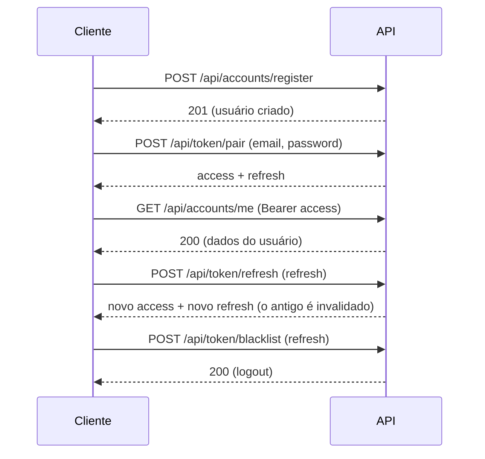

# 👤 Accounts — Usuários e Autenticação

Este documento descreve o app [`apps/accounts`](../apps/accounts), responsável pelo usuário customizado e pela autenticação via JWT.

---

## Visão geral

- O **e-mail é o identificador único** do usuário. Não existe `username`.
- A autenticação da API usa **JWT** com o pacote [`django-ninja-jwt`](https://github.com/eadwinCode/django-ninja-jwt).
- O Django Admin também faz login por e-mail.

| Arquivo                                       | Responsabilidade                                     |
| --------------------------------------------- | ---------------------------------------------------- |
| [`models.py`](../apps/accounts/models.py)     | `User` customizado e `UserManager` baseado em e-mail |
| [`api.py`](../apps/accounts/api.py)           | Rotas `register` e `me`                              |
| [`admin.py`](../apps/accounts/admin.py)       | Admin do usuário sem o campo `username`              |
| [`tests.py`](../apps/accounts/tests.py)       | Testes do fluxo completo de autenticação             |
| [`config/api.py`](../config/api.py)           | Registro do controller de tokens JWT                 |
| [`config/settings.py`](../config/settings.py) | `AUTH_USER_MODEL` e configuração `NINJA_JWT`         |

---

## Modelo de usuário

`accounts.User` herda de `AbstractUser`, com estas diferenças:

- `username = None` remove o campo herdado.
- `email` é obrigatório e `unique=True`.
- `USERNAME_FIELD = "email"` e `REQUIRED_FIELDS = []`.
- O `UserManager` normaliza o e-mail para minúsculas em `create_user` e `create_superuser`.

Em [`config/settings.py`](../config/settings.py):

```python
AUTH_USER_MODEL = "accounts.User"
```

> [!IMPORTANT]
> `AUTH_USER_MODEL` precisa existir **antes da primeira migração**. Se um banco foi criado com o usuário padrão do Django, apague o `db.sqlite3` e rode `uv run python manage.py migrate` de novo.

---

## Endpoints

Todos ficam sob o prefixo `/api`.

| Método | Rota                     | Autenticação | Descrição                                  |
| ------ | ------------------------ | ------------ | ------------------------------------------ |
| `POST` | `/api/accounts/register` | Pública      | Cria uma conta com e-mail e senha          |
| `GET`  | `/api/accounts/me`       | Bearer token | Retorna os dados do usuário autenticado    |
| `POST` | `/api/token/pair`        | Pública      | Login: retorna `access` e `refresh`        |
| `POST` | `/api/token/refresh`     | Pública      | Troca um `refresh` válido por novos tokens |
| `POST` | `/api/token/verify`      | Pública      | Verifica se um token é válido              |
| `POST` | `/api/token/blacklist`   | Pública      | Invalida um `refresh` (logout)             |

### `POST /api/accounts/register`

Corpo:

```json
{
  "email": "voce@exemplo.com",
  "password": "S3nh@Forte!2026",
  "first_name": "",
  "last_name": ""
}
```

| Status | Quando                                                                      |
| ------ | --------------------------------------------------------------------------- |
| `201`  | Conta criada. Retorna `id`, `email`, `first_name`, `last_name`              |
| `409`  | Já existe uma conta com esse e-mail (comparação sem diferenciar maiúsculas) |
| `422`  | E-mail inválido ou senha reprovada pelos validadores do Django              |

### `GET /api/accounts/me`

Exige o cabeçalho `Authorization: Bearer <access>`. Sem token, ou com token inválido, retorna `401`.

---

## Fluxo de autenticação



Exemplo com `curl`:

```bash
# 1. Registrar
curl -X POST http://localhost:8000/api/accounts/register \
  -H "Content-Type: application/json" \
  -d '{"email": "voce@exemplo.com", "password": "S3nh@Forte!2026"}'

# 2. Login
curl -X POST http://localhost:8000/api/token/pair \
  -H "Content-Type: application/json" \
  -d '{"email": "voce@exemplo.com", "password": "S3nh@Forte!2026"}'

# 3. Rota protegida
curl http://localhost:8000/api/accounts/me \
  -H "Authorization: Bearer <access_token>"

# 4. Renovar tokens
curl -X POST http://localhost:8000/api/token/refresh \
  -H "Content-Type: application/json" \
  -d '{"refresh": "<refresh_token>"}'

# 5. Logout
curl -X POST http://localhost:8000/api/token/blacklist \
  -H "Content-Type: application/json" \
  -d '{"refresh": "<refresh_token>"}'
```

---

## Configuração do JWT

Em [`config/settings.py`](../config/settings.py):

```python
NINJA_JWT = {
    "ACCESS_TOKEN_LIFETIME": timedelta(minutes=30),
    "REFRESH_TOKEN_LIFETIME": timedelta(days=7),
    "ROTATE_REFRESH_TOKENS": True,
    "BLACKLIST_AFTER_ROTATION": True,
}
```

| Opção                      | Efeito                                                 |
| -------------------------- | ------------------------------------------------------ |
| `ACCESS_TOKEN_LIFETIME`    | O `access` expira em 30 minutos                        |
| `REFRESH_TOKEN_LIFETIME`   | O `refresh` expira em 7 dias                           |
| `ROTATE_REFRESH_TOKENS`    | Cada `/token/refresh` devolve também um `refresh` novo |
| `BLACKLIST_AFTER_ROTATION` | O `refresh` anterior é invalidado após a rotação       |

A blacklist depende do app `ninja_jwt.token_blacklist` em `INSTALLED_APPS`, que cria as tabelas `OutstandingToken` e `BlacklistedToken`.

Os tokens são assinados com HS256 usando a `SECRET_KEY` do projeto, lida do `.env`. Qualquer pessoa com essa chave consegue forjar tokens válidos, por isso ela nunca deve ir para o repositório.

### Protegendo novas rotas

```python
from ninja_jwt.authentication import JWTAuth


@router.get("/protegida", auth=JWTAuth())
def protegida(request):
    return {"email": request.auth.email}
```

`request.auth` contém a instância do usuário autenticado.

---

## Senhas

- Armazenadas com o hash padrão do Django (PBKDF2).
- No registro, passam pelos validadores de `AUTH_PASSWORD_VALIDATORS`: similaridade com dados do usuário, tamanho mínimo, senhas comuns e senhas só numéricas.

---

## Superusuário

Interativo:

```bash
uv run python manage.py createsuperuser
```

Ou pelo script da raiz, que cria o usuário ou promove e redefine a senha se ele já existir:

```bash
uv run python create_superuser.py

# Com outros valores
SUPERUSER_EMAIL=outro@exemplo.com SUPERUSER_PASSWORD=outra uv run python create_superuser.py
```

> [!WARNING]
> O [`create_superuser.py`](../create_superuser.py) tem e-mail e senha padrão escritos no código. Use apenas em desenvolvimento local.

---

## Testes

```bash
uv run python manage.py test accounts
```

Os testes em [`tests.py`](../apps/accounts/tests.py) cobrem:

- Registro com normalização do e-mail para minúsculas.
- Rejeição de e-mail duplicado (`409`).
- Login e acesso a `/me` com o `access`.
- Refresh com rotação.
- Logout via blacklist e rejeição do `refresh` invalidado (`401`).
- Acesso a `/me` sem token (`401`).
- Login com senha errada (`401`).

---

## Melhorias planejadas para produção

Os itens abaixo ficaram de fora do ambiente de desenvolvimento de propósito e devem entrar antes de expor a API publicamente.

### Limite de requisições (rate limiting)

**Situação atual:** `/api/token/pair` e `/api/accounts/register` aceitam tentativas ilimitadas, o que permite força bruta contra senhas e criação de contas em massa.

**Por que ainda não foi ativado:** limites baixos atrapalham testes e scripts locais.

**Abordagem prevista:** usar o throttling já disponível no Django Ninja / `django-ninja-extra`. Exemplo para uma rota do router:

```python
from ninja.throttling import AnonRateThrottle


@router.post("/register", response={201: UserOut}, throttle=[AnonRateThrottle("5/m")])
def register(request, payload: RegisterIn): ...
```

Para o login, que vem do controller do `ninja_jwt`, o limite pode ser aplicado com o decorator `throttle` de `ninja_extra.throttling` em um controller próprio que estenda o `NinjaJWTExtendedController`.

Pontos de atenção:

- O throttling usa o cache do Django. Com mais de um processo ou servidor, é preciso um cache compartilhado (Redis, por exemplo), senão cada processo conta separadamente.
- Atrás de proxy ou load balancer, o IP do cliente precisa vir do cabeçalho correto (`X-Forwarded-For`), senão todos os usuários parecem ter o mesmo IP.

### Confirmação de e-mail

**Situação atual:** a conta fica ativa assim que é criada, sem provar que o e-mail pertence a quem se registrou. Além disso, o `409` no registro revela quais e-mails já têm conta (enumeração de usuários).

**Por que ainda não foi ativado:** exige um serviço real de envio de e-mail. Hoje o backend de e-mail está em modo `console`.

**Abordagem prevista:**

1. Configurar um provedor de e-mail (SMTP, Amazon SES, SendGrid etc.) com credenciais no `.env`.
2. Criar o usuário com `is_active=False` no registro.
3. Enviar um link com token assinado e com validade, usando o `default_token_generator` do Django ou `django.core.signing`.
4. Criar uma rota de confirmação que valida o token e ativa a conta.
5. Responder ao registro sempre com a mesma mensagem genérica ("Se o e-mail for válido, você receberá um link de confirmação"), existindo conta ou não, para eliminar a enumeração.

Com a confirmação no lugar, o mesmo mecanismo de token serve de base para a **recuperação de senha**.
